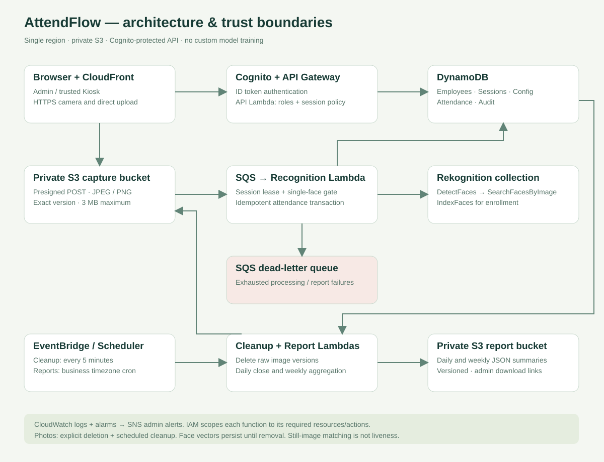
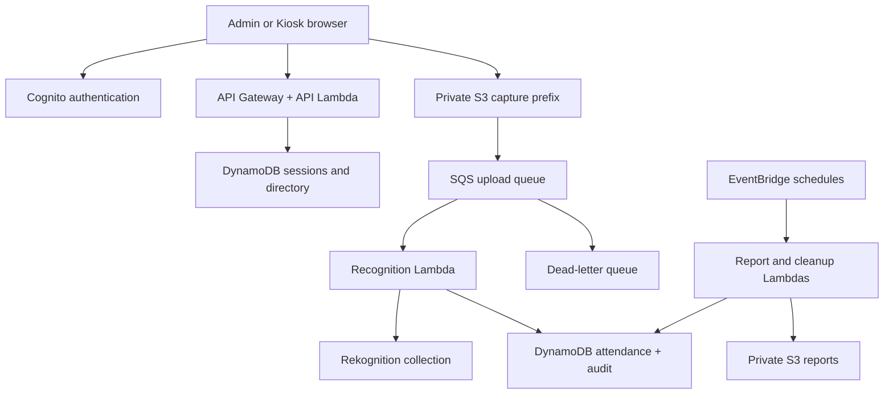

# Technical Design Document — AttendFlow

Version 1.0 · 16 October 2026 · Intended scale: a 100-employee demonstration.

## 1. Objectives and explicit boundaries

Provide contactless clock-in/out with an auditable employee/date record and a manual alternative.
An admin enrolls an employee after recording consent. A trusted kiosk captures attendance;
no anonymous uploads, public collection searches or public employee-list endpoint exist.
This is a single-organization, single-region application. It is not a production payroll,
physical access control, anti-spoofing or employee-monitoring system.

The source requirement’s one-hour S3 lifecycle TTL is technically unavailable. We implement
immediate version deletion after terminal processing and a five-minute cleanup job for images
older than one hour. AWS scheduling failures/retries mean this is a target, not a guaranteed upper bound.
The three-second response is similarly a measured target; the application visibly handles delays.

## 2. Architecture

CloudFront serves static HTML/CSS/JS from a private S3 origin with OAC and HTTPS. Cognito
ID tokens authenticate API requests. API Lambda checks the intended app-client ID, then
Admin/Kiosk group membership. CORS permits the deployed CloudFront origin; CORS is not authorization.
Presigned upload policies bind the exact key, content type, size limit and SSE-S3 encryption.

SQS is deliberately inserted between the S3 event and recognition Lambda for retry/DLQ handling.
The S3 upload still triggers recognition automatically. Queueing adds variable latency; no zero-latency
claim is made. Batch size is one, with no batching delay configured. Visibility is 360 seconds
for a 60-second handler. Partial-batch failures identify only messages that should be retried.

## 3. Registration flow

1. Admin creates a UUID employee, name, department, start date, weekday schedule and late cutoff.
2. The admin records voluntary consent; a manual-only employee can be created without it.
3. API creates an owner-bound enrollment session, then a 60-second presigned upload policy.
4. Browser uploads a JPEG/PNG, maximum 3 MB. The event contains an exact S3 VersionId.
5. Worker claims a session lease, accepts one S3 version and validates the actual bytes.
6. DetectFaces must return exactly one face. Confidence >=99, brightness/sharpness >=35,
   and absolute pitch/yaw <=25 are demo quality gates; these are not measured accuracy guarantees.
7. A short global enrollment lock serializes enrollment search/index/commit operations.
   SearchFacesByImage checks whether a high-similarity face is already linked to another employee.
8. IndexFaces stores one vector with ExternalImageId=employee_id. Employee version, session completion
   and audit record are committed together. Retries with identical image/collection/external ID use
   Rekognition’s documented duplicate-index behavior.
9. Raw S3 object version is deleted. Consent withdrawal clears directory matching first, then removes
   all vectors for that employee. Interrupted/orphan indexing is reconciled by cleanup.

Near-matches below the duplicate threshold can still produce duplicate real-person enrollments.
Administrative identity verification and careful review are essential; this is not a proof of uniqueness.

## 4. Attendance flow and consistency

Session request records action `in` or `out` and owner. Browser cannot choose an employee_id for
attendance matching. S3 LastModified of the accepted version is the authoritative event time;
browser clocks and queue processing delay do not determine the clock time.

DetectFaces applies the single-face quality gates. SearchFacesByImage returns up to five matches
above similarity 98. The best must meet the configured threshold (default 99); another employee
within one similarity point makes the result ambiguous. Matched FaceId must equal the current
employee’s enrollment FaceId. Active status and consent are checked again before committing.

A DynamoDB transaction combines:

- Attendance Put conditional on the row version, or row absence for a first write.
- Employee ConditionCheck on version and active state.
- Session DONE conditional on the worker’s lease token and PROCESSING state.
- One audit event with event_id=session_id, conditional on absence.

A retry sees DONE and does not write again. Concurrent captures for the same day cannot both
replace the same version. A distinct second clock-in is a business rejection. Clock-out without
clock-in, repeated clock-out or non-increasing timestamps is also rejected. Out-of-order queue
delivery may reject clock-out if clock-in has not committed; the portal requires waiting for clock-in
success. Later manual correction is available if needed.

The worker lease lasts 100 seconds, longer than the 60-second Lambda timeout. Upload sessions
accept objects uploaded within 120 seconds of issue (the signed policy itself lasts 60 seconds).
Processing failures retry; images needed for infrastructure retries are retained until terminal
completion or cleanup. Session metadata TTL is 24 hours but DynamoDB TTL is asynchronous.

## 5. Attendance policy

`employee_id` + local ISO date identifies one daily row. Clock timestamps are UTC ISO values;
the local business timezone is stored with each row. A local weekday must belong to the employee’s
schedule, the date must be on/after start_date and on/before end_date if set, and it must not be a holiday.
A clock-in later than `late_after` is late; exactly at the cutoff is present. Clock-out preserves status.

One shift/day, no cross-midnight shifts, half-days, paid-leave integration or breaks. A missing
clock-out is flagged separately in reports; it does not turn an attended day into an absence.
Only an audited admin correction can replace an existing daily record through the portal.

Employee schedules/cutoffs are fixed at creation in this UI. Global holidays and similarity are
editable with optimistic policy version checks. Policy updates do not rewrite attendance history.
Regenerating a report uses the current eligibility rules, so document policy changes when comparing
reports. A production design needs effective-dated policy history and leave/schedule integration.

## 6. Daily close and weekly reports

EventBridge Scheduler evaluates business-timezone cron expressions:

- Daily 23:59: mark eligible employees with no row as absent; save a provisional daily report.
- Daily 00:10: reconcile the previous day and overwrite its current report version. A valid
  clock-in arriving in the final minute may replace an absent row atomically.
- Monday 01:00: generate the previous Monday–Sunday report and backfill missing eligible days.

Report S3 versioning preserves previous report objects; it is not an immutable/WORM audit system.
Each report includes generated_at, date range, timezone, provisional flag, per-employee metrics and rows.
Manual regeneration is asynchronous. Daytime current-day previews do not invent absences;
percentages cover recorded/closed eligible days, not everyone expected to arrive later that day.

Present % = (on-time days + late days) / eligible recorded days × 100.
Late % = late days / eligible recorded days × 100.
Absence % = absent days / eligible recorded days × 100.
The report’s scheduled_days field counts included eligible rows; an empty denominator yields 0.

## 7. IAM and failure handling

Runtime policies are separate from deployer policies. The recognition function can access only
this stack’s table actions, raw S3 prefix and Rekognition collection. DetectFaces is a stateless API
requiring Resource="*"; collection APIs are scoped. It cannot write report or frontend buckets.
Report writes only reports/* and reads directory/policy/attendance. Cleanup deletes raw versions
and removed/orphan face vectors. No hard-coded AWS keys exist in frontend/backend code.

CloudWatch logs exclude raw photos, ID tokens and signed upload URLs. SNS sends operational
alarms to the confirmed admin subscription. Exhausted upload messages and asynchronous report
failures reach SQS DLQ. Operators inspect the failure before redriving; redriving after image cleanup
cannot restore a photo and must not fabricate an attendance record.

## 8. Acceptance and enhancement path

See demo-guide.md for live checks. Measure cold and warm upload-to-result latency, recognition
errors and rejection rates with a consented demo group before describing performance.
Useful future work: Rekognition Face Liveness; individual user authentication plus face verification;
effective-dated schedules/approved leave; paginated/indexed reporting; stronger admin MFA and
immutable audit retention. These features are not silently assumed to exist in this release.

## Sources

- https://docs.aws.amazon.com/rekognition/latest/APIReference/API_SearchFacesByImage.html
- https://docs.aws.amazon.com/rekognition/latest/APIReference/API_IndexFaces.html
- https://docs.aws.amazon.com/lambda/latest/dg/services-sqs-configure.html
- https://docs.aws.amazon.com/scheduler/latest/UserGuide/schedule-types.html
- https://docs.aws.amazon.com/AmazonS3/latest/userguide/troubleshoot-lifecycle.html
